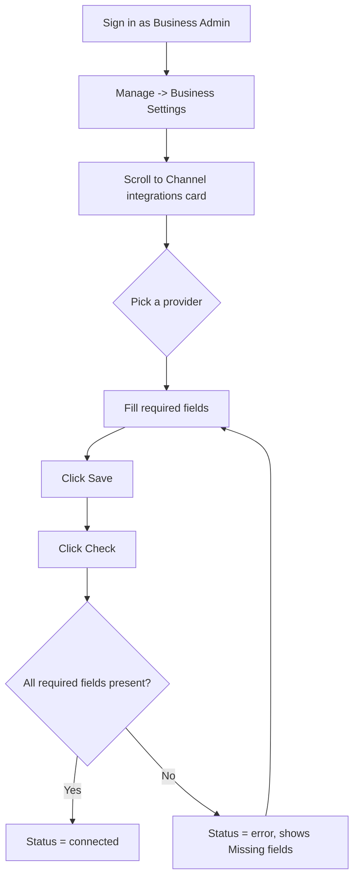
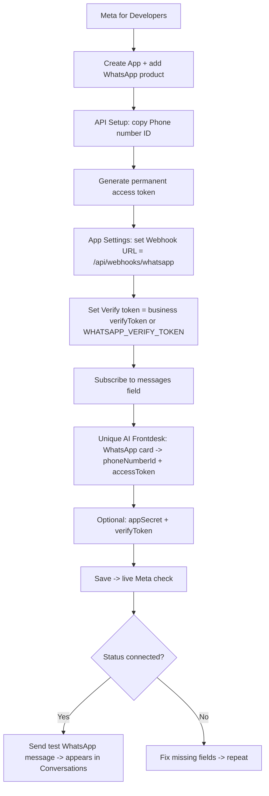
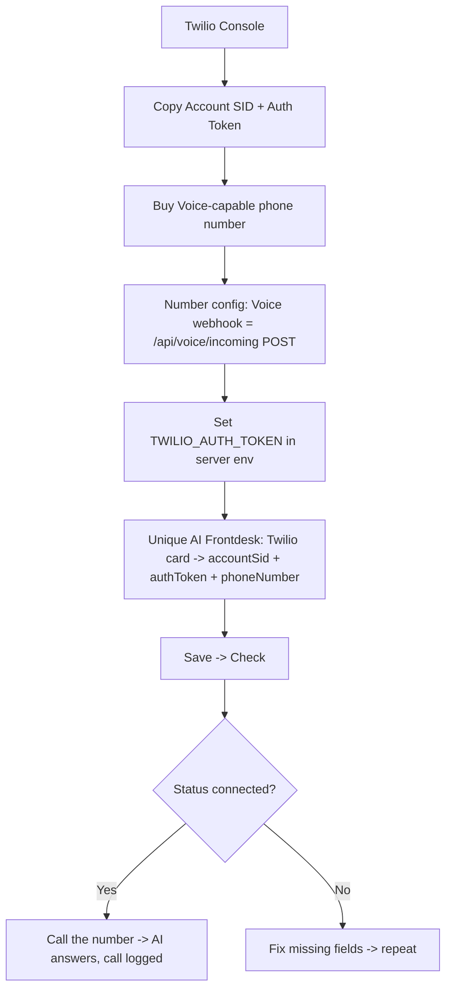
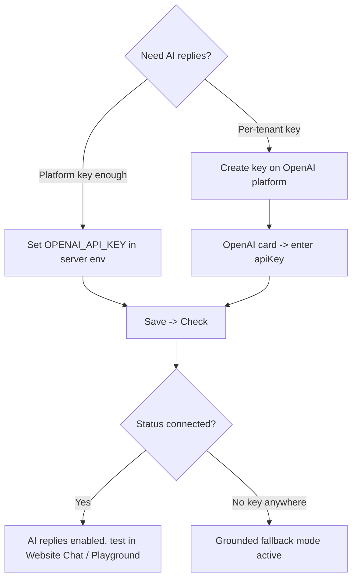
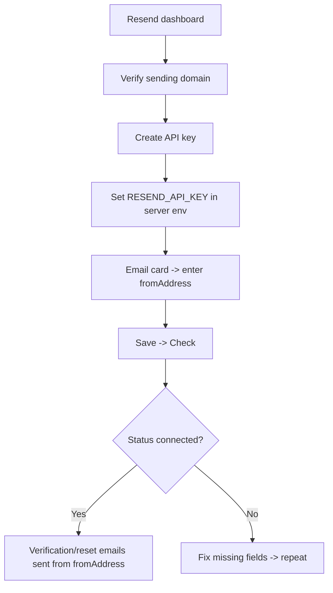
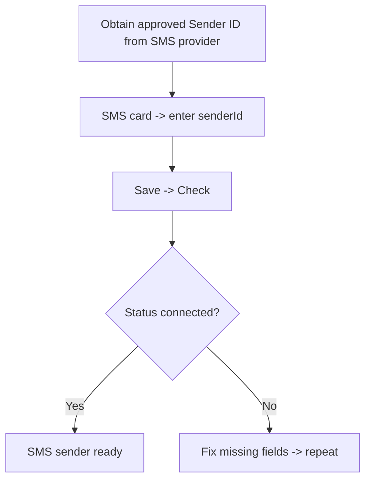
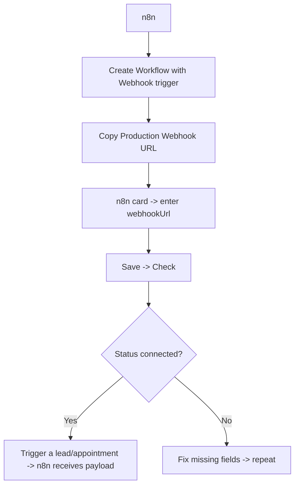

# Channel Integrations — Help Guide

> **Audience:** Business Admins of a tenant workspace.
> **Where:** Sign in as Business Admin → **Manage → Business Settings** → scroll to the **Channel integrations** card at the bottom of the page.

This guide explains how to connect each messaging/voice/AI channel to your business workspace, what credentials are
needed, where to get them, and which webhook URLs to give to the provider. Every step below is also shown as a
flowchart so you can follow the exact order.

---

## 1. How the integration card works

- Six providers are always listed: **WhatsApp**, **Twilio** (voice), **OpenAI**, **Email**, **SMS**, **n8n**.
- Each card shows a **status badge**: `disconnected` / `connected` / `error`.
- **Needs:** the list of fields that must be filled before the provider can be marked connected.
- **Save** stores the credentials per business (encrypted at rest, masked in the UI as `••••••••`).
- **Check** validates that all required fields are present and flips status to `connected` or `error`.
- Secrets are never returned in full after saving — re-saving with the masked placeholder keeps the old value.

---

## 2. WhatsApp Cloud API

**Required fields:** `phoneNumberId`, `accessToken`
**Optional per-business fields:** `appSecret` (Meta App Secret), `verifyToken` (webhook verify token)
**Optional platform fallback (server env):** `WHATSAPP_APP_SECRET`, `WHATSAPP_VERIFY_TOKEN`

Har business apna `appSecret` aur `verifyToken` card me save kar sakta hai. Jab tak wo set nahi hain, platform env fallback use hota hai — isliye multi-tenant setup me dono per-business fields bharna behtar hai.

### Where to get the values
1. Go to [Meta for Developers](https://developers.facebook.com/) → **My Apps** → create/select your app.
2. Add the **WhatsApp** product to the app.
3. Under **WhatsApp → API Setup**, copy the **Phone number ID** and generate a **Permanent access token** (System User token recommended for production).
4. Set the **Webhook URL** to `https://<your-domain>/api/webhooks/whatsapp`.
5. Set the **Verify token** to the same value you save in the app's `verifyToken` field for this business (or the platform `WHATSAPP_VERIFY_TOKEN` when no per-business token is set).
6. Subscribe to the `messages` webhook field.

### Steps in the app
1. Business Settings → Channel integrations → **WhatsApp** card.
2. Enter `phoneNumberId` and `accessToken`.
3. Optionally enter `appSecret` and `verifyToken` so this business's webhooks are verified with its own Meta app. Setup wizard me ye dono skip kiye ja sakte hain.
4. Click **Save** — it runs the live Meta check automatically.
5. Send a test message to your WhatsApp Business number; it should appear in **Conversations**.

---

## 3. Twilio Voice (AI receptionist calls)

**Required fields:** `accountSid`, `authToken`, `phoneNumber`
**Server env:** `TWILIO_AUTH_TOKEN`

### Where to get the values
1. Sign in to [Twilio Console](https://console.twilio.com/).
2. Copy **Account SID** and **Auth Token** from the dashboard.
3. Buy/choose a Twilio phone number with Voice capability.
4. Under the number's **Voice & Fax → A CALL COMES IN**, set the webhook to `https://<your-domain>/api/voice/incoming` (HTTP POST).
5. Set `TWILIO_AUTH_TOKEN` in your server env to the same Auth Token (used for signature verification).

### Steps in the app
1. Business Settings → Channel integrations → **Twilio** card.
2. Enter `accountSid`, `authToken`, `phoneNumber` (E.164, e.g. `+1...`).
3. Click **Save**, then **Check**.
4. Call the Twilio number; the AI answers with TwiML and the call appears in **Voice Calls**.

---

## 4. OpenAI (AI replies)

**Required fields:** `apiKey` (per business, optional — platform key can be used)
**Server env:** `OPENAI_API_KEY`, `OPENAI_MODEL`

- If `OPENAI_API_KEY` is set on the server, the platform uses it for every business (shown as "Platform AI key: configured").
- A business may also store its own `apiKey` in the integration card to override/enable AI for that tenant.
- Without any key, the assistant runs in **grounded fallback mode** (retrieval-only, Hindi notice on grounded answers).

### Steps in the app
1. (Optional) Create an API key at [platform.openai.com](https://platform.openai.com/api-keys).
2. Business Settings → Channel integrations → **OpenAI** card.
3. Enter `apiKey` (or leave empty to rely on the platform key).
4. Click **Save**, then **Check**.

---

## 5. Email (Resend)

**Required fields:** `fromAddress`
**Server env:** `RESEND_API_KEY`, `MAIL_FROM`, `APP_URL`

- Used for verification codes and password-reset emails.
- Create an account at [Resend](https://resend.com/), verify your domain, and create an API key.
- Set `RESEND_API_KEY` (and optionally `MAIL_FROM`, `APP_URL`) in server env.
- In the app, store the verified sender address as `fromAddress`.

### Steps in the app
1. Resend dashboard → verify domain → create API key → set `RESEND_API_KEY` in env.
2. Business Settings → Channel integrations → **Email** card.
3. Enter `fromAddress` (e.g. `noreply@yourdomain.com`).
4. Click **Save**, then **Check**.

---

## 6. SMS

**Required fields:** `senderId`
**Optional:** provider-specific API credentials (store under `config`).

- Set the approved sender ID (DLT-registered in India) as `senderId`.
- Add any provider API keys to the integration config as needed.

### Steps in the app
1. Business Settings → Channel integrations → **SMS** card.
2. Enter `senderId`.
3. Click **Save**, then **Check**.

---

## 7. n8n (automation webhooks)

**Required fields:** `webhookUrl`
**No server env needed.**

- Create a workflow in [n8n](https://n8n.io/) with a **Webhook** trigger node.
- Copy the production webhook URL.
- Paste it as `webhookUrl` so the app can push events (new leads, appointments, etc.) to your automation.

### Steps in the app
1. n8n → create Workflow → add Webhook node → copy Production URL.
2. Business Settings → Channel integrations → **n8n** card.
3. Enter `webhookUrl`.
4. Click **Save**, then **Check**.
5. Trigger an event (e.g. new lead) and confirm n8n receives it.

---

## 8. Troubleshooting

| Symptom | Likely cause | Fix |
| --- | --- | --- |
| Status stays `error` with "Missing: ..." | Required field not filled or left blank | Fill the listed fields, Save, Check again |
| WhatsApp messages not arriving | Webhook not subscribed or wrong verify token | Re-check Meta webhook URL/token and `messages` subscription |
| Twilio calls not answered | Voice webhook not set or wrong URL | Set A CALL COMES IN → `/api/voice/incoming` (POST) |
| AI replies in fallback mode | No `OPENAI_API_KEY` and no per-tenant key | Set server env or enter `apiKey` in OpenAI card |
| Emails not sent | `RESEND_API_KEY` missing or domain unverified | Verify domain in Resend, set env, re-Check |
| n8n not receiving events | Wrong webhook URL or workflow inactive | Activate workflow, copy Production URL, re-Save |

---

## 9. Security notes

- Credentials are stored **per business** (tenant-scoped) and **masked** in API responses.
- Re-entering the masked placeholder `••••••••` does **not** overwrite the stored secret.
- WhatsApp and Twilio webhooks verify **provider signatures**; unsigned requests are rejected in production.
- Never share your access tokens or auth tokens in chat, logs, or screenshots.

---

*Generated for Unique AI Frontdesk. Keep this file with your ops docs; update it when new providers are added.*